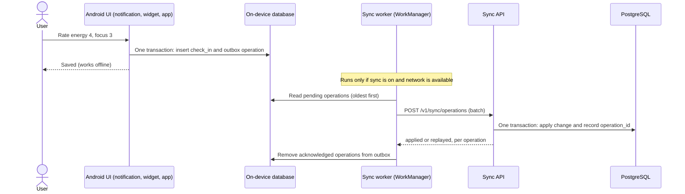
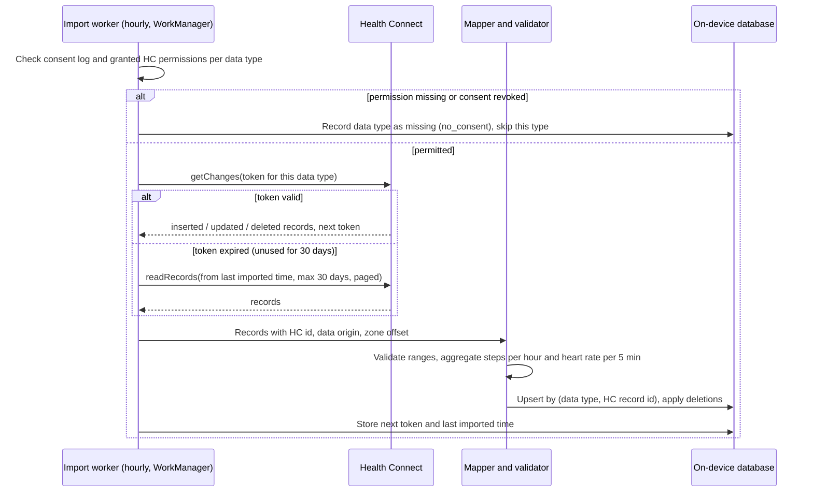
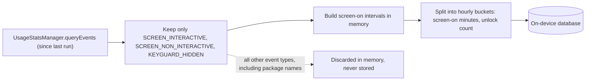
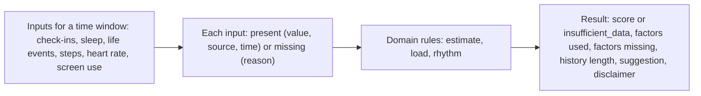

# Data flow

- Status: Accepted for the MVP
- Last updated: 2026-11-27

How data enters FlowWave, where it is stored, how it is turned into estimates,
and how it is synchronized. Components are described in the
[system overview](system-overview.md).

## Data by location

| Data | Origin | On device | Server (only if sync is on) | Never stored |
| --- | --- | --- | --- | --- |
| Energy and focus check-ins | User | Yes | Yes | |
| Meals (time, size) | User | Yes | Yes | Food descriptions, photos, calories |
| Caffeine (time, rough amount: small / medium / large) | User | Yes | Yes | Product names |
| Exercise (start, end, intensity: light / moderate / hard) | User or Health Connect | Yes | Yes | GPS routes |
| Rest and breaks (start, end) | User | Yes | Yes | |
| Sleep sessions (start, end, stages if available) | Health Connect or user | Yes | Yes | |
| Steps | Health Connect | Hourly totals | Hourly totals | Per-step samples |
| Heart rate | Health Connect | 5-minute min / average / max; daily resting value | Same | Raw beat-level samples |
| Screen use | `UsageStatsManager` | Screen-on minutes and unlock count per hour | Same | Package names, app usage, raw events |
| Consent decisions | User | Yes | Yes | |
| Estimates and suggestions | Computed on device | Recomputed on demand; cached | No (recomputed from inputs) | |

Each row gets a [data inventory](../privacy/data-inventory.md) entry in the
phase that implements it.

## Manual check-ins and life events

The user's tap is stored locally first, together with an outbox entry, in one
database transaction ([0007](0007-android-offline-first-storage.md)). Sync is
a separate, optional step.

Skipping a check-in creates no row. When the estimate needs that input, it is
represented as missing with reason `user_skipped` or `not_recorded`
([0002](0002-time-and-missing-data.md)).

## Health Connect import

Rules:

- One changes token per data type, so revoking one permission does not break
  the others.
- Records are keyed by Health Connect record ID, so re-reading after token
  expiry creates no duplicates.
- Steps are read through the Health Connect aggregate API, which applies the
  user's data-source priority, so phone and band steps are not double counted.
- A night without a sleep record is stored as missing (`not_recorded` or
  `source_unavailable`), never as zero sleep.
- Health Connect records include a zone offset; FlowWave stores the UTC instant,
  that offset, and the device's IANA time zone at import time.
- FlowWave never writes to Health Connect in the MVP.

## Screen-use aggregation

- Runs at least every few hours, because Android keeps usage events only for a
  limited number of days.
- Needs the user to grant Usage access in system settings. Without it, screen
  use is missing with reason `no_consent`.
- Per-app or per-category breakdowns are out of scope for the MVP and would need
  their own decision note.

## Estimates and suggestions

- Computed on the device, so it works offline. The server does not compute
  estimates in the MVP.
- Results are derived data: they can always be recomputed from inputs and are
  not synchronized.

## Synchronization, deletion, export

- Sync is off until the user creates an account and turns it on.
- Operations follow [0004](0004-offline-first-idempotent-sync.md): the
  client generates the operation ID; the server replays results for repeated IDs
  and rejects reused IDs with a different payload.
- Deleting an entry creates a tombstone that syncs like any other change.
- Turning sync off keeps local data and stops uploads. Deleting the account
  deletes all server data for that user (cascade, covered by SQL tests).
- Export produces a file with all of the user's data in a documented JSON
  format, generated on the device.

## Time handling

- The device captures the instant in UTC, the IANA time zone, and the offset
  at the moment of the event.
- Local-day views use the zone stored with each event, so travel does not
  rewrite history.

## Assumptions

- Mi Fitness writes sleep sessions, steps, and heart rate to Health Connect on
  the owner's phone.
- Hourly background import is enough for day planning; the user can also
  refresh manually.

## Risks

| Risk | Mitigation |
| --- | --- |
| Health Connect read quotas, stricter in the background | Changes API instead of full re-reads; batch per data type; back off on quota errors. |
| Wearable data arrives late (Mi Fitness syncs irregularly) | Imports are idempotent and estimates are recomputed when late data arrives. |
| Usage events expire before collection | Collector runs several times a day; a gap is stored as missing. |
| Duplicate steps from several sources | Aggregate API with Health Connect data-source priority. |

## Non-goals

- Server-side analytics on health data.
- Real-time streaming from the band.
- Storing raw heart-rate samples or raw usage events.

## Acceptance criteria

- Re-running any import or sync step with the same input leaves the stored
  data unchanged (tested).
- Revoking a Health Connect permission or usage access stops that collection on
  the next run and marks the input as missing with reason `no_consent`.
- No stored table contains package names, window titles, URLs, file names,
  message contents, or keystrokes (checked by the core privacy guard and code
  review).
- Every stored event has a UTC instant, an IANA time zone, and an offset.
