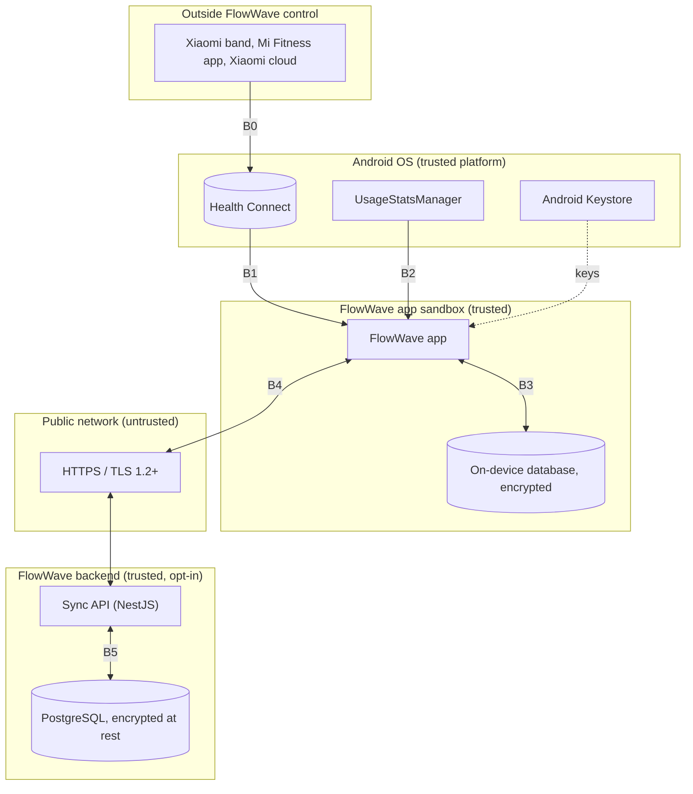

# Security boundaries

- Status: Accepted for the MVP
- Last updated: 2026-11-27

FlowWave processes special-category personal data (health data under GDPR
art. 9) and behavior data. This document lists the trust boundaries, what
crosses each one, and the controls at each crossing.

## Trust zones

## Boundaries and controls

| ID | Boundary | What crosses | Controls |
| --- | --- | --- | --- |
| B0 | Xiaomi to Health Connect | Sleep, steps, heart rate written by Mi Fitness | Outside FlowWave's control. FlowWave never talks to the band or the Xiaomi cloud. |
| B1 | Health Connect to app | Only the record types the user granted | Per-type Health Connect permissions; matching consent decision in the core consent log; read-only; permission rationale screen as required by Health Connect; background and history permissions requested only when the feature needs them. |
| B2 | UsageStatsManager to app | Screen on/off and unlock events | Usage access granted by the user in system settings; only three event types are used; package names are never persisted ([data flow](data-flow.md#screen-use-aggregation)). |
| B3 | App to on-device storage | All user data | Database encrypted with a key held in Android Keystore (library chosen in [0007](0007-android-offline-first-storage.md)); excluded from Android cloud backup and device-to-device transfer; no health data in shared storage, logs, or notifications' lock-screen content. |
| B4 | App to network | Sync operations, auth tokens | Only when the user turned on sync; HTTPS with TLS 1.2+; no cleartext traffic allowed; short-lived access tokens stored with Keystore protection; payloads checked by the privacy guard before upload. |
| B5 | API to database | Validated operations | Server re-validates every payload (`parseSyncOperation`, privacy guard); database role with least privilege (no superuser, no DDL at runtime); encryption at rest and encrypted backups; per-user row scoping in every query. |
| B6 | Logs, crash reports, analytics | Diagnostics | No third-party analytics or advertising SDKs in the MVP; logs and crash reports contain no health values, no tokens, and no identifiers beyond a random installation ID. |

## Threats and mitigations

| Threat | Example | Mitigation |
| --- | --- | --- |
| Spoofing | Someone calls the API as another user | Authenticated requests; user ID taken from the token, never from the payload. |
| Tampering | Replayed or altered sync operations | Idempotency log keyed by operation ID with payload fingerprint; conflicting reuse rejected. |
| Repudiation | Dispute over what the user consented to | Append-only consent log with policy version and zoned timestamp; updates blocked by a database trigger. |
| Information disclosure | Lost phone, cloud backup, logs | Encrypted local database, backup exclusion, no health data in logs or lock-screen notifications. |
| Information disclosure | Collecting more than needed | Data inventory as the source of truth; privacy guard rejects forbidden fields; screen use aggregated in memory. |
| Denial of service | Very large sync batches | Batch size and request rate limits on the API. |
| Elevation of privilege | Database compromise through the API | Least-privilege database role; parameterized queries only. |

## User rights (GDPR)

| Right | How FlowWave supports it |
| --- | --- |
| Consent and withdrawal | Per-source, per-scope consent; withdrawal stops collection on the next run. |
| Access and portability | Export of all user data as documented JSON, generated on the device. |
| Erasure | Delete local data in the app; delete the account to remove all server data (cascade). |
| Minimization | Only fields listed in the data inventory are collected. |

## Assumptions

- The Android OS, Health Connect, and Android Keystore are trusted.
- The server is hosted in the EU when sync is launched; the provider is chosen
  in the API phase.

## Risks

| Risk | Mitigation |
| --- | --- |
| Rooted or compromised device | Out of scope to fully prevent; encryption at rest limits casual extraction. |
| Mi Fitness or Xiaomi cloud handles data differently than FlowWave | Stated in onboarding: FlowWave reads only what Mi Fitness already put in Health Connect. |
| Future features pressure to collect app names or content | Requires a new decision note and inventory change; the privacy guard and the project rules forbid content data. |

## Non-goals

- Protecting data on a device the attacker fully controls.
- End-to-end encryption of server backups in the MVP (a later decision note may
  add it).

## Acceptance criteria

- Android manifest disallows cleartext traffic and excludes the database from
  backups (checked in phase 1 review).
- A test proves that sync payloads containing forbidden fields are rejected on
  both the device and the server.
- A test proves that a Health Connect data type with revoked permission is not
  read and is reported as missing with reason `no_consent`.
- Logs from a full test run contain no health values (checked in CI by
  grepping test log output for known test values).
- Account deletion removes every row for the user (existing SQL test, extended
  for each new table).
