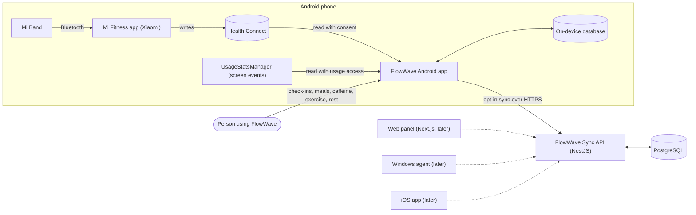

# System overview

- Status: Accepted for the MVP, except the mobile UI stack (see [0005](0005-android-first-native-kotlin.md), Proposed)
- Last updated: 2026-11-27

FlowWave learns a person's own daily rhythm of energy, focus, load, recovery,
sleep, activity, screen use, meals, and rest, and turns it into explained
suggestions for planning the day. It is a self-observation tool, not a medical
device (see [`docs/product/vision.md`](../product/vision.md)).

Related documents: [data flow](data-flow.md),
[security boundaries](security-boundaries.md),
[MVP scope](../product/mvp-scope.md), and the decision notes listed in the
[index](README.md).

## Context



Dashed components are not part of the MVP.

## Components

| Component | Responsibility | Technology | Decision |
| --- | --- | --- | --- |
| Android app | All user-facing features; works fully offline; owns the user's primary copy of the data | Native Kotlin (proposed) | [0005](0005-android-first-native-kotlin.md), [0007](0007-android-offline-first-storage.md) |
| Health Connect adapter (in app) | Reads sleep, steps, heart rate, and exercise sessions written by Mi Fitness or other apps | Health Connect Jetpack client | [0006](0006-health-connect-wearable-gateway.md) |
| Screen-use collector (in app) | Turns screen on/off and unlock events into per-hour totals | Android `UsageStatsManager` | [data flow](data-flow.md#screen-use-aggregation) |
| Domain rules | Time handling, explicit missing data, consent, privacy guard, idempotent sync, explained estimates | `@flowwave/core` (TypeScript), mirrored in Kotlin with shared test vectors | [0001](0001-monorepo-and-shared-core.md)–[0004](0004-offline-first-idempotent-sync.md) |
| Sync API | Optional backup and sync; idempotent operation intake; export and account deletion | NestJS on Node.js | [0008](0008-nestjs-sync-api.md) |
| Database | Server copy for users who opt in to sync | PostgreSQL | [0001](0001-monorepo-and-shared-core.md), `db/migrations` |
| Web panel (later) | Larger views of rhythm and patterns | Next.js | Decision note before work starts |
| Windows agent (later) | Active and idle minutes from the system idle timer | To be decided | Decision note before work starts |
| iOS app (later) | Same features with Apple Health | To be decided | Decision note before work starts |

## Domain vocabulary

All of these are personal estimates, not clinical measures.

| Term | Meaning in FlowWave |
| --- | --- |
| Energy | Self-rated energy (1–5), optionally combined with sleep relative to the person's own goal into an energy estimate. |
| Focus | Self-rated ability to concentrate (1–5). |
| Load | How demanding a recent period was, from observable inputs: length of uninterrupted work or screen blocks, time since the last break, and heart rate above the person's own resting level. |
| Overload | A load estimate above the person's own usual range. Shown as "higher load than usual", never as a condition. |
| Recovery | Inputs associated with returning to baseline: breaks, rest events, movement, sleep. |
| Rhythm | The person's typical energy and focus by time of day, computed from their own history. |
| Check-in | A quick self-rating of energy and focus. |
| Life event | A logged meal, caffeine intake, exercise, or rest period. |

## Planned repository layout

```text
apps/android/        Native Android app (phase 1)
apps/api/            NestJS sync API (phase 4)
apps/web/            Next.js web panel (later)
packages/core/       Shared domain rules (exists)
db/                  PostgreSQL migrations and SQL tests (exists)
docs/                Architecture, product, privacy (exists)
```

## Quality attributes

| Attribute | Target |
| --- | --- |
| Privacy | Data stays on the device unless the user turns on sync. No third-party analytics or advertising SDKs. |
| Offline | Every MVP feature except sync works without a network. |
| Explainability | Every estimate and suggestion lists its inputs, missing inputs, and history length. |
| Correctness under retries | Every sync operation is idempotent ([0004](0004-offline-first-idempotent-sync.md)). |
| Battery | Background work is batched with WorkManager; target under 2% battery per day for FlowWave's own work. |
| Time | Every event is stored as UTC plus original time zone and offset ([0002](0002-time-and-missing-data.md)). |

## Assumptions

- The owner's band can be paired with Mi Fitness, and Mi Fitness writes sleep,
  steps, and heart rate to Health Connect on the owner's phone. To be verified
  on the device before phase 2.
- Android 9 (API 28) or newer. Health Connect is built in from Android 14 and
  available as an app on Android 9–13.
- One Android device per person in the MVP; multi-device sync comes later.
- Users accept short self-ratings a few times a day; the rhythm view needs about
  two to three weeks of data.

## Risks

| Risk | Impact | Mitigation |
| --- | --- | --- |
| Zepp Life has no direct Health Connect link, and the Google Fit route ends in 2026 | No wearable data for older bands | Move the band to Mi Fitness; manual sleep logging always works ([0006](0006-health-connect-wearable-gateway.md)). |
| Mi Fitness stops syncing when the system kills it in the background | Gaps in wearable data | Show gaps as missing with reason; onboarding explains battery-optimization settings. |
| Domain rules diverge between TypeScript core and Kotlin app | Inconsistent estimates or sync bugs | Shared JSON test vectors run in both test suites ([0005](0005-android-first-native-kotlin.md)). |
| Google Play policy review for health and usage-access permissions | Release delay | Request only needed permissions, with in-app rationale and a privacy policy that matches the data inventory. |
| Low check-in adherence | Too little data for a rhythm | One-tap check-ins from notifications and a widget; the app works with partial data and says so. |

## Non-goals

- Diagnosing, treating, or monitoring ADHD or any other condition; medication tracking or dosing advice.
- Direct Bluetooth connection to Xiaomi or other wearables.
- Reading app names, window titles, URLs, notifications, messages, or keystrokes.
- Server-side processing as a requirement for any feature.
- iOS, web panel, and Windows agent in the MVP.

## Acceptance criteria

- Every component in the table above has an accepted decision note before its
  implementation starts.
- Each MVP feature in [`mvp-scope.md`](../product/mvp-scope.md) maps to a
  component in this document.
- Every data element in the [data flow](data-flow.md) appears in
  [`data-inventory.md`](../privacy/data-inventory.md) before it is collected.
- Every boundary in [security boundaries](security-boundaries.md) has at least
  one automated test or review checklist item in the phase that implements it.
