# Entity–relationship diagram

Tables and relations of the FlowWave database. Columns are described in the
[data dictionary](data-dictionary.md); decisions in
[0012](../architecture/0012-data-model.md).

Every relation to `users` is `ON DELETE CASCADE`, except `audit_events`
(`SET NULL`). Relations to `devices` and `health_data_sources` are composite
foreign keys `(id, user_id)`, so a row can only point at a device or source of
the same user. Bookkeeping columns (`created_at_utc`, `updated_at_utc`,
`deleted_at_utc`, `version`) and the time zone and offset that accompany every
`*_at_utc` column are left out of the diagram for readability.

```mermaid
erDiagram
    users ||--o{ devices : "registers"
    users ||--o{ consent_decisions : "decides"
    users ||--o{ health_data_sources : "connects"
    users ||--o{ check_ins : "records"
    users ||--o{ meal_events : "logs"
    users ||--o{ caffeine_events : "logs"
    users ||--o{ rest_events : "logs"
    users ||--o{ focus_sessions : "runs"
    users ||--o{ daily_scores : "receives"
    users ||--o{ rhythm_buckets : "receives"
    users ||--o{ recommendations : "receives"
    users ||--o{ applied_sync_operations : "submits"
    users |o--o{ audit_events : "is subject of"
    health_data_sources ||--o{ health_samples : "provides"
    health_data_sources ||--o{ sleep_sessions : "provides"
    health_data_sources ||--o{ activity_sessions : "provides"
    devices ||--o{ device_usage_buckets : "measures"
    devices ||--o{ sync_checkpoints : "tracks"

    users {
        uuid id PK
        varchar home_time_zone
        smallint sleep_goal_minutes "nullable"
        boolean is_synthetic
    }
    devices {
        uuid id PK
        uuid user_id FK
        device_platform platform
        varchar app_version "nullable"
        timestamptz last_seen_at_utc "nullable"
    }
    consent_decisions {
        uuid id PK
        uuid user_id FK
        text source_id
        text state "granted or revoked"
        text_array scopes
        varchar policy_version
        timestamptz decided_at_utc
    }
    health_data_sources {
        uuid id PK
        uuid user_id FK
        health_source_kind kind
        varchar source_key UK "unique per user"
        varchar provider_package "nullable"
        varchar recording_device_model "nullable"
    }
    health_samples {
        uuid id PK
        uuid user_id FK
        uuid data_source_id FK
        health_metric metric
        measurement_unit unit
        timestamptz start_at_utc
        timestamptz end_at_utc
        double value "nullable"
        missing_reason value_missing_reason "nullable"
        varchar source_record_id UK "per source"
        varchar idempotency_key UK "per user"
    }
    sleep_sessions {
        uuid id PK
        uuid user_id FK
        uuid data_source_id FK
        timestamptz start_at_utc
        timestamptz end_at_utc
        smallint deep_sleep_minutes "nullable"
        missing_reason stages_missing_reason "nullable"
        varchar idempotency_key UK "per user"
    }
    activity_sessions {
        uuid id PK
        uuid user_id FK
        uuid data_source_id FK
        activity_type activity_type
        timestamptz start_at_utc
        timestamptz end_at_utc
        activity_intensity intensity "nullable"
        varchar idempotency_key UK "per user"
    }
    device_usage_buckets {
        uuid id PK
        uuid user_id FK
        uuid device_id FK
        timestamptz bucket_start_at_utc UK "per device"
        integer screen_on_seconds "nullable"
        integer unlock_count "nullable"
        integer app_switch_count "nullable"
        integer social_seconds "one of seven categories"
        missing_reason missing_reason "nullable"
        varchar idempotency_key UK "per user"
    }
    check_ins {
        uuid id PK
        uuid user_id FK
        timestamptz recorded_at_utc
        smallint self_reported_energy "nullable, 1 to 5"
        smallint sleep_duration_minutes "nullable"
    }
    meal_events {
        uuid id PK
        uuid user_id FK
        timestamptz eaten_at_utc
        meal_type meal_type
        portion_size size "nullable"
    }
    caffeine_events {
        uuid id PK
        uuid user_id FK
        timestamptz consumed_at_utc
        portion_size amount "nullable"
    }
    rest_events {
        uuid id PK
        uuid user_id FK
        rest_type rest_type
        timestamptz start_at_utc
        timestamptz end_at_utc "nullable"
    }
    focus_sessions {
        uuid id PK
        uuid user_id FK
        timestamptz start_at_utc
        timestamptz end_at_utc "nullable"
        smallint planned_duration_minutes "nullable"
        focus_outcome outcome "nullable"
        smallint self_rated_focus "nullable, 1 to 10"
    }
    daily_scores {
        uuid id PK
        uuid user_id FK
        date local_date UK "with score_type and version"
        score_type score_type
        calculation_status status
        double score_value "nullable"
        varchar calculation_version
        jsonb explanation "factors and disclaimer"
    }
    rhythm_buckets {
        uuid id PK
        uuid user_id FK
        timestamptz bucket_start_at_utc UK "with version"
        calculation_status status
        rhythm_state state "nullable"
        double energy_level "nullable"
        jsonb explanation "factors and disclaimer"
    }
    recommendations {
        uuid id PK
        uuid user_id FK
        recommendation_kind kind
        varchar template_key
        jsonb parameters
        jsonb explanation "factors and disclaimer"
        recommendation_status status
    }
    sync_checkpoints {
        uuid id PK
        uuid user_id FK
        uuid device_id FK
        varchar stream UK "per device"
        varchar cursor
    }
    applied_sync_operations {
        uuid operation_id PK
        uuid user_id FK
        text entity_type
        uuid entity_id
        text payload_fingerprint
        jsonb result
    }
    audit_events {
        uuid id PK
        uuid user_id FK "nullable"
        audit_action action
        varchar entity_type "nullable"
        jsonb metadata "no health values"
    }
```

